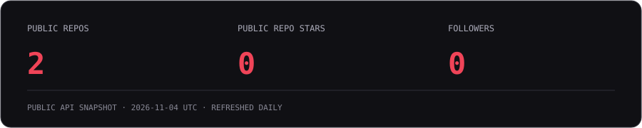

  

### `01 / whoami`

Hey, I'm **LishayGFX**. Welcome to my corner of GitHub.

Code, pixels, and everything in between. Explore the projects below to see what I'm sharing.

[GitHub ↗](https://github.com/LishayGFX) · [Public repositories ↗](https://github.com/LishayGFX?tab=repositories)

### `02 / ls projects/`

| Project | Inside |
| :--- | :--- |
| **[Atlas Survival resource pack ↗](https://github.com/LishayGFX/atlas-survival-resource-pack)** | Official Atlas Survival Minecraft resource pack releases. |
| **[This profile ↗](https://github.com/LishayGFX/LishayGFX)** | A custom red/black terminal, animated SVGs, and a daily public GitHub snapshot. |

### `03 / git status --public`

Public GitHub data, refreshed daily. Stars count owned public repositories; no private repository data or estimated activity. [View current profile ↗](https://github.com/LishayGFX)

### `04 / contributions --animate`

[Contribution calendar ↗](https://github.com/LishayGFX?tab=overview) · [Refresh history ↗](https://github.com/LishayGFX/LishayGFX/actions/workflows/profile.yml)

---

`lishaygfx@github:~$` **Thanks for stopping by.**
