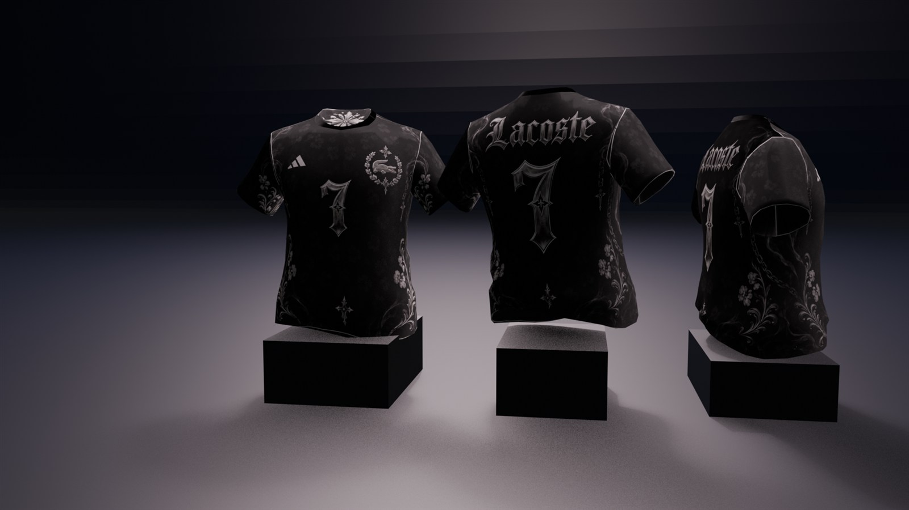

  <a href="https://openowl.cc">openowl.cc ↗</a>
  &nbsp; · &nbsp;
  <a href="https://valkbypass.com">valkbypass.com ↗</a>
  &nbsp; · &nbsp;
  <a href="https://github.com/LishayGFX/atlas-survival-resource-pack">Atlas Survival ↗</a>
  &nbsp; · &nbsp;
  <a href="https://github.com/LishayGFX?tab=repositories">Repositories</a>

  Discord:
  <a href="https://discord.com/users/731165672448589887">@lishaygfx</a>
  &nbsp; · &nbsp;
  <a href="https://discord.com/users/202518120479457282">@neverwentlegit</a>

### FiveM clothing design

About this profile

Public repository and follower counts are refreshed daily. Stars count owned public repositories. The date shown is the last successful refresh, not a live counter.

[Latest Atlas release](https://github.com/LishayGFX/atlas-survival-resource-pack/releases/latest) · [Maintenance and data sources](PROFILE.md)

