  <a href="https://github.com/LishayGFX/atlas-survival-resource-pack">Atlas Survival ↗</a>
  &nbsp; · &nbsp;
  <a href="https://github.com/LishayGFX?tab=repositories">Repositories</a>
  &nbsp; · &nbsp;
  <a href="https://github.com/LishayGFX?tab=overview">Contributions</a>

About this profile

Public repository and follower counts are refreshed daily. Stars count owned public repositories. The date shown is the last successful refresh, not a live counter.

[Maintenance and data sources](PROFILE.md)

